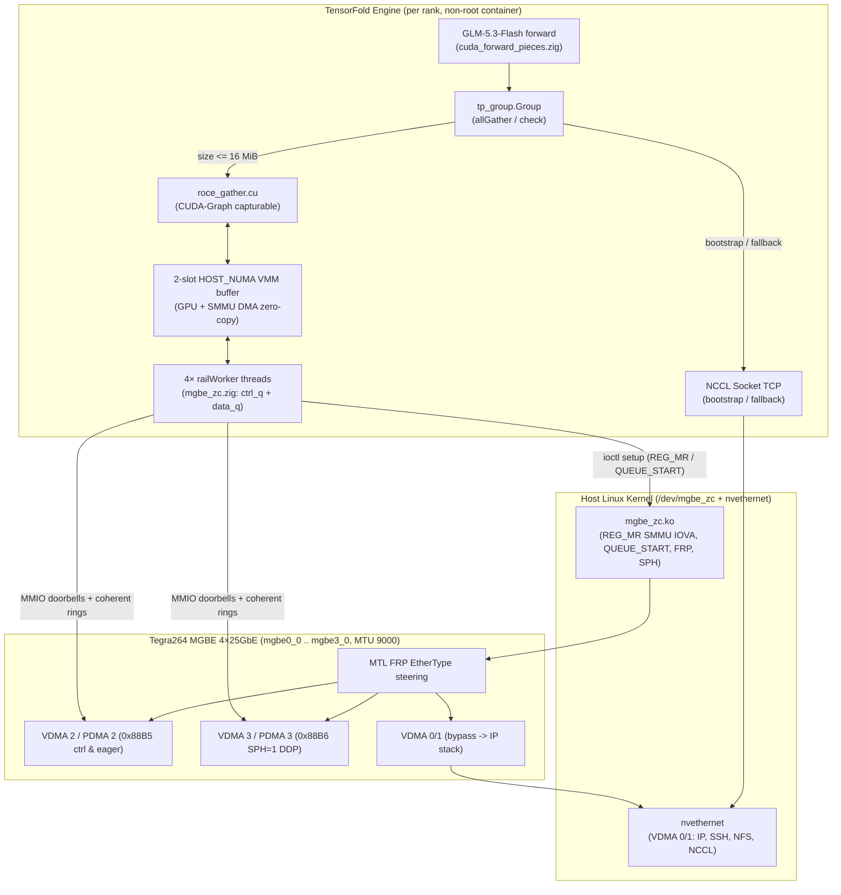

# Running on two Jetson AGX Thor (`sm_110a` + `/dev/mgbe_zc`)

This recipe was written for two DGX Sparks (GB10, `sm_121`, ConnectX-7 RoCE). On two **Jetson AGX Thor** nodes
(`sm_110a`, 4 × 25 GbE MGBE ports in the 100G QSFP cage, no RDMA verbs device), the launcher detects the platform
automatically and enables both the `sm_110a` kernel optimizations and zero-copy 4-rail `/dev/mgbe_zc` TP=2
communication.

## Hardware & launcher differences

| | DGX Spark (GB10) | Jetson AGX Thor |
| --- | --- | --- |
| GPU compute capability | `12.1` → `SM=121` | `11.0` → `SM=110a` |
| EXL3 prompt kernel | `mma.sync` | `tcgen05` 5th-gen tensor core + TMEM (`sm_110a`, patch `0019`) |
| EXL3 grouped decode load | `AHEAD` (`__CUDA_ARCH__ >= 1200`) | `AHEAD` (`__CUDA_ARCH__ >= 1100`, patch `0017`) |
| Interconnect | ConnectX-7 RoCE (`libibverbs`) | 4 × 25 GbE MGBE Ethernet (`mgbe0_0..mgbe3_0`, MTU 9000) |
| Engine TP=2 all-gather | `roce.zig` (`TF_ROCE=1`) | `/dev/mgbe_zc` 4-rail zero-copy (`TF_MGBE_ZC=1`, patch `0018`) |
| NCCL fallback / bootstrap | IB verbs | Socket (TCP) across all 4 MGBE rails (`NCCL_IB_DISABLE=1`) |
| Docker GPU passthrough | `--gpus all` | `--runtime=nvidia -e NVIDIA_VISIBLE_DEVICES=all` |
| CUDA runtime floor | `cuda>=13.3` | Relaxed automatically to host driver CUDA (`13.2` on JetPack 7.2) |

## System architecture & `/dev/mgbe_zc` integration

`/dev/mgbe_zc` is integrated across three layers — host kernel, launcher/Docker, and the TensorFold Zig/CUDA engine — while coexisting with standard Linux networking (SSH, NFS, NCCL bootstrap/fallback) on the same four 25 GbE MGBE ports:



### 1. Host & hardware layer
- **Device Tree reservation**: `nvethernet` is restricted to `nvidia,dma-chans = <0 1>` on all four MGBE controllers (`mgbe0_0`–`mgbe3_0`), leaving `VDMA 2` (`PDMA 2`) and `VDMA 3` (`PDMA 3`) free for `/dev/mgbe_zc`.
- **Kernel driver (`mgbe_zc.ko`)**:
  - Exposes `/dev/mgbe_zc` (`0660`, group `mgbe_zc` via udev) so non-root containers can open it with `--device /dev/mgbe_zc --group-add <gid>`.
  - `MGBE_ZC_IOC_REG_MR` pins the CUDA `HOST_NUMA` staging buffer and per-port header pools (`FOLL_LONGTERM`) and maps contiguous 48-bit SMMU IOVAs across all four MGBE platform devices.
  - `MGBE_ZC_IOC_QUEUE_START` programs the hardware MTL Flexible Receive Parser (**FRP**): EtherType `0x88B5` → `VDMA 2` (`ctrl_q`), `0x88B6` → `VDMA 3` (`data_q`), and bypass (`AF|RF`) → `VDMA 0/1` (`nvethernet`).
  - Enables hardware Split Header (**SPH**, `MAC_EXT_CFG1` offset 52 = 64 B header split) on `VDMA 3` so 8 KiB DDP payloads land directly in the `HOST_NUMA` receive slot with zero CPU copies.

### 2. Launcher & container layer (`scripts/nodes.sh`, `scripts/prepare.sh`, `start.sh`)
1. **Architecture (`SM=auto`)**: `nvidia-smi --query-gpu=compute_cap` returning `11.0` selects `SM=110a` (enabling `tcgen05` EXL3 prompt SASS).
2. **Fabric & rails (`scripts/nodes.sh`)**: Without an RDMA device, discovers all point-to-point subnets ≥ `FABRIC_MIN_SPEED_MBPS` (`10000`, excluding 1G LAN), verifies jumbo MTU in both directions (`ping -M do -s 8972`), sets `NCCL_SOCKET_IFNAME=mgbe0_0,mgbe1_0,mgbe2_0,mgbe3_0`, sets `NCCL_IB_DISABLE=1`, and forces `ROCE=off`.
3. **Zero-copy device wiring (`scripts/prepare.sh`, `start.sh`)**: When `MGBE_ZC=auto` (or `on`) and `/dev/mgbe_zc` exists on both nodes, resolves `MGBE_ZC_PORTS` (`0,1,2,3`), looks up the `mgbe_zc` group GID on each host, passes `--device /dev/mgbe_zc --group-add <gid>`, and exports `TF_MGBE_ZC=1`, `TF_MGBE_ZC_MAX_KB=16384`, `TF_MGBE_ZC_EAGER_KB=32`, `TF_MGBE_ZC_PORTS`, and `TF_GLM_PREFILL_REDUCE=gather` (so prefill exchanges use 4-rail DDP all-gather).
4. **GPU runtime & CUDA floor**: `GPU_RUNTIME=auto` selects `--runtime=nvidia` and relaxes `NVIDIA_REQUIRE_CUDA` when JetPack's driver reports an older minor CUDA version than the container base image.

### 3. Engine dataplane (`zig/src/cuda/mgbe_zc.zig`, patches `0018` & `0020`)
- **Initialization & probe**: `tp_group.Group.openMgbeZc()` allocates the 2-slot `CU_MEM_LOCATION_TYPE_HOST_NUMA` staging region, exchanges MACs over NCCL, runs a bidirectional `ctrl` + `SPH=1` DDP wire probe on every rail, and spawns one `railWorker` thread per port. If either rank fails probe, both fall back cleanly to NCCL Socket TCP.
- **GPU stream interface**: `allGather()` launches `kernels.roce_gather` on the CUDA stream (100% CUDA-Graph capturable). The kernel stages `send[slot]`, rings the `ctrl.seq` doorbell, polls per-rail completion flags in `HOST_NUMA`, and scatters `recv[slot]` into the output tensor.
- **Dual-path transport**:
  - **Eager (`<= TF_MGBE_ZC_EAGER_KB`, default 32 KiB/rail)**: 0.5-RTT raw L2 frames on `VDMA 2` (`0x88B5`) with 500 µs retry and post-exit `flag_retrans` reply (~13–23 µs decode/verify gathers).
  - **DDP bulk (`> 32 KiB/rail`, up to 16 MiB/rank)**: Hardware split-header DDP on `VDMA 3` (`0x88B6`) in up to 512-packet (4 MiB) windows with CTS/ACK, Go-Back-N `Op.nack` flush+resend, post-exit `Op.ack` `flag_retrans` reply, `tx_sent == win_pkts` completion guard, bounded `peer_max_seq` window, 50 ms total-loss window recovery, and `ctrl_q` drain-on-error so peer retries cannot back up the shared MAC RX FIFO.

## Launching & operating the service

### 1. Host prerequisites (both Thor nodes)
1. **DTB + MTU 9000 + `mgbe_zc.ko`**: Complete the host setup below so all four `mgbe0_0`–`mgbe3_0` interfaces are `UP` at MTU 9000 with point-to-point IPs (e.g. `192.168.100–103.{38,39}/24`), `/dev/mgbe_zc` exists with `root:mgbe_zc` `0660`, and `./tests/zc_hw_selftest` passes on ports `0..3`.
2. **Passwordless SSH**: Rank 0 (`thor`) must reach rank 1 (`thor2`) with key-based SSH (`ssh test@192.168.100.39 hostname`).
3. **Weights**: Either sync to both disks (`WORKER_WEIGHTS=rsync`, default) or export rank 0's cache over NFSv3 (`WORKER_WEIGHTS=nfs`).

### 2. Configure `scripts/local.sh` (on rank 0)
Create `scripts/local.sh` (gitignored; overrides `scripts/config.sh`):

```bash
# Worker target (on a 25G rail or 1G LAN; fabric rails are auto-discovered)
WORKER=test@192.168.100.39
PORT=8020

# Weights over NFSv3 (omit if worker has its own local copy via rsync)
WORKER_WEIGHTS=nfs
NFS_OPTS='vers=3,ro,rsize=1048576,wsize=1048576,hard,timeo=600'

# Serving & zero-copy transport
MGBE_ZC=on
PARALLEL=4
CONTEXT=524288
KV=fp8
DENSE=q8
HEAD=bf16
MEMORY_RESERVE_GIB=12
HOST_CACHE_GIB=0
```

### 3. Start, verify, and stop
```bash
# Build image (first run or after patch changes), sync image to worker, start both ranks, and run smoke test
./start.sh

# Check API health
curl -s http://127.0.0.1:8020/health

# Confirm all 4 /dev/mgbe_zc rails came up in rank 0 logs
docker logs glm53-spark 2>&1 | grep 'mgbe_zc all-gather'
# Expected:
#   info: mgbe_zc all-gather: 2 ranks, 4 rail(s), shards up to 16384 KiB (eager <= 32 KiB/rail, DDP above)

# Stop both ranks cleanly (saves compressed logs to logs/)
./stop.sh
```

### 4. Common runtime overrides
```bash
# Disable /dev/mgbe_zc and fall back to NCCL Socket TCP (for A/B comparison)
MGBE_ZC=off ./start.sh

# Use a subset of MGBE ports or pin rail workers to dedicated CPUs
MGBE_ZC_PORTS=0,1,2 ./start.sh
MGBE_ZC_CPUS=2,3,4,5 ./start.sh
```

## Host setup for `/dev/mgbe_zc` (both nodes)

The `/dev/mgbe_zc` kernel module ([hengwen1/mgbe_zc](https://github.com/hengwen1/mgbe_zc)) exposes direct userspace
VDMA queues (`VDMA 2` for `0x88B5` control/eager frames and `VDMA 3` with hardware split-header DDP for `0x88B6` bulk
frames) while leaving normal IP/SSH/NFS/NCCL traffic on `VDMA 0/1`.

On **both** Jetson AGX Thor nodes:

```bash
# 1. Build and load mgbe_zc.ko (requires DTB nvidia,dma-chans = <0 1> on mgbe0..mgbe3)
git clone https://github.com/hengwen1/mgbe_zc.git
cd mgbe_zc && make && make tests

# 2. Allow non-root container access via dedicated group + udev rule
sudo groupadd -f mgbe_zc
sudo usermod -aG mgbe_zc "$USER"
echo 'KERNEL=="mgbe_zc", GROUP="mgbe_zc", MODE="0660"' | sudo tee /etc/udev/rules.d/99-mgbe-zc.rules
sudo udevadm control --reload-rules

# 3. Load module and verify device permissions + self-test
sudo insmod ./mgbe_zc.ko
ls -l /dev/mgbe_zc   # crw-rw---- 1 root mgbe_zc
./tests/zc_hw_selftest --ports 0,1,2,3
```

## Engine patches for Thor (`0017`–`0023`)

- **`0017-glm-cuda-sm110a-exl3-ahead-and-TF_GLM_MM_CUBLAS.patch`**:
  - Enables `GROUPED_LOAD = tf_exl3::AHEAD` for `__CUDA_ARCH__ >= 1100` in `exl3_experts.cu`.
  - Adds `-gencode=arch=compute_110,code=sm_110` to `mailbox.cu` fatbin.
  - Ports opt-in `TF_GLM_MM_CUBLAS=1` (off by default, `TF_GLM_MM_CUBLAS_MIN_ROWS=128`) with 1:1 `plain_keys`/`plain_vals`
    tracking (fixing mixed `head_bits=16` / `dense_bits=8` lookup alignment) and per-stream cuBLASLt workspaces.
- **`0018-cuda-mgbe-zc-4-rail-tp2-all-gather.patch`**:
  - Implements `zig/src/cuda/mgbe_zc.zig` + `mgbe_zc_uapi.zig`, wired into `tp_group.Group` and `cuda_forward_pieces.zig`.
  - Allocates the 2-slot staging region via CUDA VMM `CU_MEM_LOCATION_TYPE_HOST_NUMA` (directly accessible by GPU
    `roce_gather` kernels and `/dev/mgbe_zc` `FOLL_LONGTERM` contiguous 48-bit SMMU DMA).
  - Reuses `kernels.roce_gather` on the CUDA stream so decode/verify all-gathers are **100% CUDA-Graph capturable**.
  - Uses 0.5-RTT raw L2 eager frames for small/decode stripes (`<= 32 KiB/rail`) and hardware split-header DDP (`SPH=1`,
    8 KiB payload landing directly into CUDA `HOST_NUMA`) for bulk/prefill stripes (`<= 16 MiB/rank`).
- **`0019-exl3-cuda-sm110a-tcgen05-prompt-kernel.patch`**:
  - Implements `tmain_tcgen05` + `tspill_tcgen05` in `zig/kernels/cuda/exl3_prompt.cuh` and `exl3_experts.cu`, gated on
    `__CUDA_ARCH__ == 1100 && defined(__CUDA_ARCH_FEAT_SM110_ALL)` (`sm_110a` only).
  - Maps EXL3 MCG `decode_tile_p` (`K2=8` 4-bit and `K2=6` 3-bit) directly into canonical 8×8 core matrices with zero
    shuffles and zero shared-memory bank conflicts (`lane == rl * 4 + kp`), stages `X` directly into canonical core
    matrices via `cp.async`, accumulates two `128×64` FP32 tiles in 128 TMEM columns via `tcgen05.mma.cta_group::1.kind::f16`,
    and spills via dual-warpgroup `tcgen05.ld.sync.aligned.32x32b.x16.b32` into the existing `fwht128` + SwiGLU epilogue.
  - Fits inside the existing static shared memory footprint (`43.3 KiB`, 52–58 registers/thread, 0 spill bytes).
- **`0020-cuda-mgbe-zc-reack-and-total-loss-ddp-recovery.patch`**:
  - Fixes lost final `Op.ack` deadlock in `runDdp()` via `flag_retrans` post-exit `Op.ack` replies in `drainCtrlRx()`.
  - Guards `tx_acked = true` with `tx_sent == win_pkts` and bounds `peer_max_seq` updates to data opcodes within `1..slots` ahead of `last_seq`.
  - Adds 50 ms total-loss DDP window recovery (`Op.nack` with bumped `cts_gen`), keeps draining `ctrl_q` on worker error to prevent MAC RX FIFO overflow from starving `VDMA 0/1` TCP/liveness, and logs `ctrl_q`/`data_q` DMA registers on timeout.
- **`0023-glm-cuda-sm110a-tcgen05-mla-and-cublas-absorb.patch`**:
  - Adds `chunks_32_tcgen05` in `zig/kernels/cuda/common/mla.cuh` (gated on `sm_110a`, `KT=128`, `M=128, N=32` `tcgen05.mma.cta_group::1.kind::f16` for both `QK^T` K-major and `PV` MN-major with `SWIZZLE_128B`, 128 TMEM columns, 0 register spills, 1-warp-per-key coalesced 16-byte FP8 loads, 8-warp parallel online softmax) with `sm_110`-only `193,536 B` dynamic SMEM in `cuda_glue.zig` / `cuda_latent.zig`.
  - Routes prompt-chunk (`rows >= 64`) `absorbQ` and `expandV` through `cuBLASLt` strided batched BF16 GEMM (`cuda_mm.zig` / `cuda_latent.zig`, gated on `TF_GLM_MM_CUBLAS=1`, zero extra VRAM, decode windows untouched), cutting 11-layer absorb+expand from ~589 ms to ~20 ms per 4,096-row pass.

## Measured kernel & transport gates on 2× Jetson AGX Thor

### 1. EXL3 prompt kernel (`tf-cuda-test exl3-prompt-k6`, 1 layer, 4096 rows, top-8 of 288 experts, D=4096, N=1024)

| Kernel path | 4-bit / 4-bit (one call) | Gate+Up | Down | 3-bit / 4-bit | 3-bit / 3-bit |
| --- | --- | --- | --- | --- | --- |
| Baseline `mma.sync` (`sm_110`) | ~205 ms | — | — | — | — |
| **`tcgen05` (`sm_110a`, patch `0019`)** | **64.61 ms** (**3.17× faster**) | **42.88 ms** | **21.38 ms** | **65.97 ms** | **66.31 ms** |

Both `tf-cuda-test exl3-prompt-k6` (max 0.0702 of float64 tolerance) and `tf-cuda-test glm-exl3` (max 0.198 of float64
tolerance across 4-bit, 3/4-bit, and 2/3/4-bit with NaN isolation) pass.

### 2. 2-node TP=2 all-gather (`tf-cuda-test mgbe-zc-gather`, 4 × 25 GbE rails, non-root container)

All 14 sizes (`64 B`..`16 MiB`), CUDA Graph capture + 32× replay, and 200 eager + 16 DDP stress exchanges passed
bit-exact against NCCL (`0` mismatches, **`0` new `mmc_rx_fifo_overflow`** across all 8 MGBE ports):

| Shard size / rank | `mgbe_zc` (4 rails) | NCCL Socket (4 rails) | Speedup |
| --- | --- | --- | --- |
| 4 KiB (decode) | **13.0 µs** (2.51 Gbps/dir) | 192.9 µs (0.17 Gbps/dir) | **14.8×** |
| 16 KiB (decode) | **16.7 µs** (7.83 Gbps/dir) | 308.7 µs (0.42 Gbps/dir) | **18.5×** |
| 32 KiB (verify) | **19.1 µs** (13.71 Gbps/dir) | 432.1 µs (0.61 Gbps/dir) | **22.6×** |
| 64 KiB (verify) | **22.9 µs** (22.90 Gbps/dir) | 452.4 µs (1.16 Gbps/dir) | **19.8×** |
| 2 MiB (prefill) | **259.0 µs** (64.79 Gbps/dir) | 1,517.0 µs (11.06 Gbps/dir) | **5.9×** |
| 8 MiB (prefill) | **1,061.0 µs** (63.25 Gbps/dir) | 5,943.8 µs (11.29 Gbps/dir) | **5.6×** |
| 16 MiB (prefill) | **2,112.9 µs** (63.52 Gbps/dir) | 11,090.6 µs (12.10 Gbps/dir) | **5.2×** |

### 3. Live TP=2 serving (`./start.sh`, DFlash2 4-bit, FP8 KV pool, Q8 dense, `sm_110a` + `/dev/mgbe_zc`)

Measured greedy (`temperature=0`, `enable_thinking=false`, fresh prompts, `0` new NIC RX FIFO overflows):

| Workload | Result | Notes |
| --- | --- | --- |
| 1-stream decode (256 tok) | **31.1 tok/s** (8.95 s, TTFT 767 ms) | vs ~17.8 tok/s over NCCL TCP (**1.75× faster**) |
| 2-stream decode (2 × 256 tok) | **35.5 tok/s agg** (20.2 tok/s/stream) | 14.41 s wall |
| 4-stream decode (4 × 256 tok) | **38.9–46.7 tok/s agg** (12.8–13.2 tok/s/stream) | 21.9–26.4 s wall |
| Cold ~4K prefill (3,948 tok) | **488.9 tok/s** (TTFT 8.08 s) | `TF_GLM_MM_CUBLAS=0`, 2048-row passes |
| Cold ~8K prefill (8,429 tok) | **479.2 tok/s** (TTFT 17.59 s) | Exact retrieval, 0 RX FIFO overflows, stays healthy |
| Cold 16K–170K prefill sweep (15.7K / 28.7K / 57.2K / 112.6K / 170.8K + 14-stream concurrent batch) | **~510 tok/s prefill**, **31.4–36.5 tok/s** decode (TTFT 29.9 s / 56.5 s / 111.2 s / 219.9 s / 336.0 s) | Patch `0020`, 4 rails (`0,1,2,3`), `TF_GLM_MM_CUBLAS=0`, 2048-row passes |
| Cold ~4K / ~10K / ~24K prefill (`GLM_MM_CUBLAS=1`, `TF_GLM_CHUNK_SOLO=4096`, `TF_GLM_OVERLAP_PIECES=8`, patch `0023`) | **626.3 / 659.4 / 698.0 tok/s** (TTFT 6.73 s / 15.42 s / 34.36 s) | Exact needle retrieval at 10K & 24K, +28–37% over `TF_GLM_MM_CUBLAS=0` baseline |

## Tuning knobs

| Setting | Default on Thor | Notes |
| --- | --- | --- |
| `SM` | `auto` (`110a`) | Override with `SM=110` to disable `tcgen05` |
| `MGBE_ZC` | `auto` (`on` when `/dev/mgbe_zc` present) | Set `MGBE_ZC=off` to fall back to NCCL Socket for A/B testing |
| `MGBE_ZC_MAX_KB` | `16384` | Max shard size routed over `/dev/mgbe_zc` (16 MiB/rank) |
| `MGBE_ZC_EAGER_KB` | `32` | Per-rail threshold between 0.5-RTT eager and hardware DDP |
| `TF_GLM_MM_CUBLAS` | `0` (off) | Opt-in cuBLASLt dense prompt GEMMs (requires ~7 GiB extra VRAM) |
